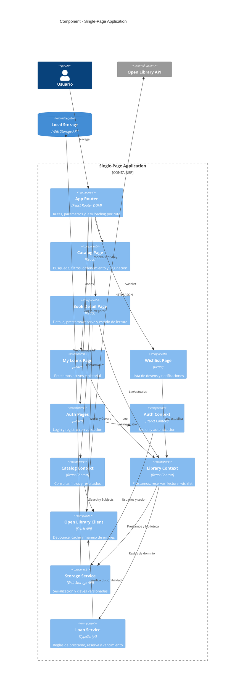
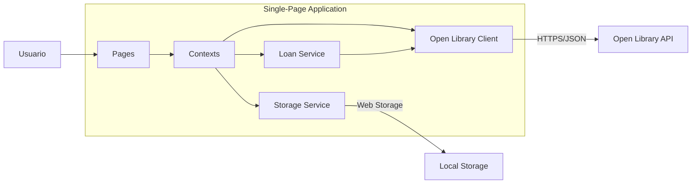

# Arquitectura del Frontend

Semana 2 - Diseño y Arquitectura

Documento de arquitectura de alto nivel de UniLibrary usando el modelo C4. Los diagramas estan escritos en Mermaid (sintaxis C4*) y se renderizan directamente en GitHub.

## Nivel 1 - System Context

El sistema es una SPA que el usuario usa desde el navegador. Consume la API publica de Open Library para el catalogo. El Local Storage del navegador (persistencia) es parte del sistema y aparece en el nivel Container.


## Nivel 2 - Container

El sistema tiene un unico container de ejecucion (la SPA React en el navegador) y un container de persistencia proporcionado por el navegador (Local Storage). No hay backend propio.


## Nivel 3 - Component

Dentro de la SPA se identifican cuatro grupos: Router, Pages, State (Context API) y Services.



## Decisiones estructurales

### Tres contextos por dominio

El estado se divide en tres contextos con responsabilidades acotadas, en lugar de un unico contexto global. Esto evita re-renders innecesarios: la pagina de catalogo no se re-renderiza cuando cambia un prestamo, y viceversa.

| Contexto | Responsabilidad |
|---|---|
| Auth Context | Usuario activo, login, registro, logout, sesion persistida. |
| Catalog Context | Consulta de busqueda, filtros activos, ordenamiento, resultados y paginacion. |
| Library Context | Prestamos, reservas, historial, estado de lectura y lista de deseos del usuario. |

### Capa de servicios desacoplada de la UI

Los componentes nunca llaman a fetch ni a localStorage directamente. Toda interaccion externa pasa por tres servicios:

| Servicio | Responsabilidad |
|---|---|
| Open Library Client | Peticiones HTTP con debounce, cache en memoria, header User-Agent identificado y manejo de errores. |
| Storage Service | Serializacion JSON, claves versionadas (unilibrary:v1:*) y manejo de errores de cuota. |
| Loan Service | Reglas de negocio de prestamos y reservas, calculo de fechas de vencimiento. |

### Disponibilidad simulada

Open Library no gestiona prestamos reales de la biblioteca universitaria. El Loan Service deriva la disponibilidad combinando el campo availability de la Search API con el estado local de prestamos de la aplicacion.

## Flujo de datos principal



## Estructura de carpetas propuesta

```
src/
  app/
    App.tsx
    router.tsx
    providers.tsx
  pages/
    catalog/
    book-detail/
    loans/
    wishlist/
    auth/
  components/
    ui/
    books/
    layout/
  contexts/
    AuthContext.tsx
    CatalogContext.tsx
    LibraryContext.tsx
  hooks/
  services/
    open-library/
    storage/
    loans/
  types/
  utils/
  styles/
```

## Nota sobre los diagramas

Los diagramas usan la sintaxis C4 de Mermaid (C4Context, C4Container, C4Component). Se renderizan automaticamente al ver este archivo en GitHub o en editores con soporte Mermaid (VS Code con la extension Markdown Preview Mermaid Support, por ejemplo).
