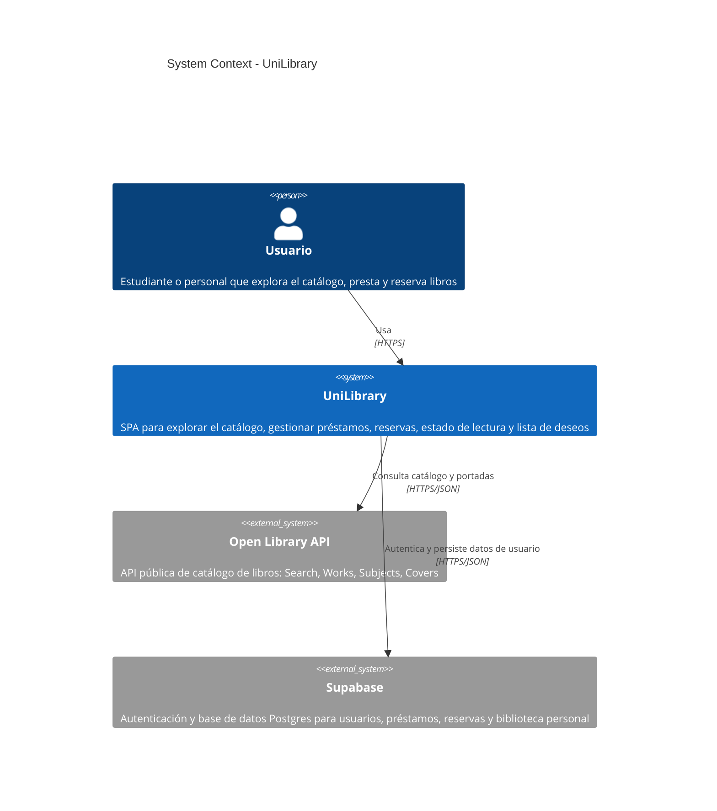
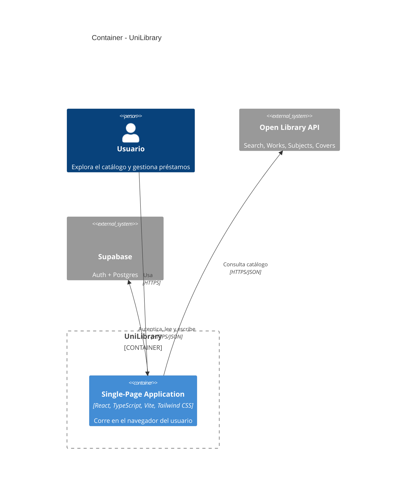
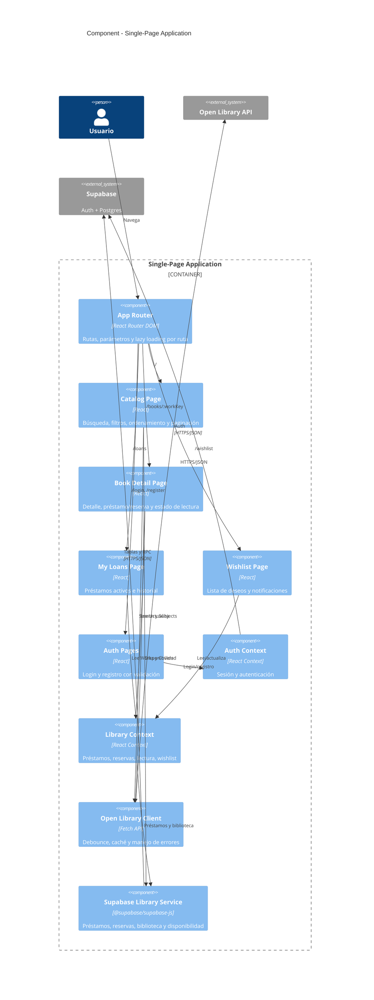
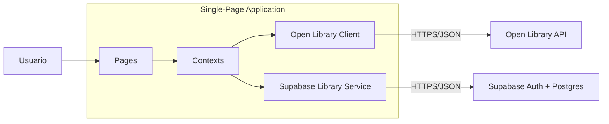

# Arquitectura del Frontend

Semana 2 - Diseño y Arquitectura

Documento de arquitectura de alto nivel de UniLibrary usando el modelo C4. Los diagramas están escritos en Mermaid (sintaxis C4*) y se renderizan directamente en GitHub.

## Nivel 1 - System Context

El sistema es una SPA que el usuario usa desde el navegador. Consume la API pública de Open Library para el catálogo y Supabase para la autenticación y la persistencia de datos de usuario.



## Nivel 2 - Container

El sistema tiene un único container de ejecución (la SPA React en el navegador) y usa Supabase como servicio externo de autenticación y persistencia. No hay backend propio.



## Nivel 3 - Component

Dentro de la SPA se identifican cuatro grupos: Router, Pages, State (Context API) y Services.



## Decisiones estructurales

### Dos contextos por dominio

El estado compartido se divide en dos contextos con responsabilidades acotadas, en lugar de un único contexto global. Esto evita re-renders innecesarios: la página de catálogo no se re-renderiza cuando cambia un préstamo, y viceversa.

| Contexto | Responsabilidad |
|---|---|
| Auth Context | Usuario activo, login, registro, logout, sesión persistida. |
| Library Context | Préstamos, reservas, historial, estado de lectura y lista de deseos del usuario. |

El estado del catálogo (consulta, filtros, ordenamiento, resultados y paginación) es local a la Catalog Page: solo esa página lo lee y modifica, por lo que vive en useState dentro del componente y se pasa por props a sus hijos. Un contexto aquí no aportaba nada: no hay consumidores fuera de la página. Revisión aplicada en Semana 3.

### Capa de servicios desacoplada de la UI

Los componentes nunca llaman a fetch ni a Supabase directamente. Toda interacción externa pasa por los servicios:

| Servicio | Responsabilidad |
|---|---|
| Open Library Client | Peticiones HTTP con caché en memoria y manejo de errores. |
| Supabase Client | Cliente @supabase/supabase-js configurado con las variables VITE_. |
| Supabase Library Service | Mappers fila/dominio y operaciones de préstamos, reservas, biblioteca y disponibilidad contra las tablas y funciones RPC. |

### Disponibilidad por préstamos activos

UniLibrary maneja un ejemplar por libro: un libro está Prestado si algún usuario tiene un préstamo activo de él (ADR-008). La disponibilidad se consulta con la función RPC loaned_work_keys por conjunto de work keys — una llamada por página de resultados — y el campo ebook_access de Open Library ya no interviene. Revisión aplicada en Semana 6: la sección anterior describía una disponibilidad simulada a partir del campo availability de la Search API.

## Flujo de datos principal



## Estructura de carpetas propuesta

```
src/
  app/
    App.tsx
    router.tsx
    providers.tsx
  pages/
    catalog/
    book-detail/
    loans/
    wishlist/
    auth/
    not-found/
  components/
    auth/
    ui/
    books/
    layout/
  contexts/
    auth-context.ts
    AuthContext.tsx
    library-context.ts
    LibraryContext.tsx
  hooks/
    useLoanedWorkKeys.ts
  services/
    open-library/
    supabase/
  types/
  utils/
  styles/
```

## Nota sobre los diagramas

Los diagramas usan la sintaxis C4 de Mermaid (C4Context, C4Container, C4Component). Se renderizan automáticamente al ver este archivo en GitHub o en editores con soporte Mermaid (VS Code con la extensión Markdown Preview Mermaid Support, por ejemplo).
