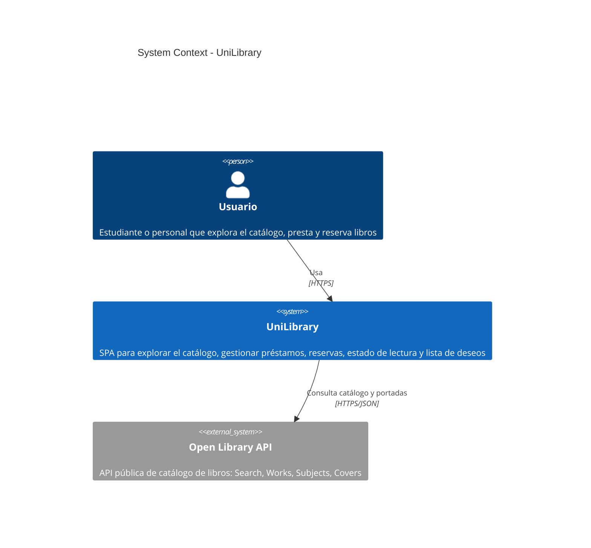
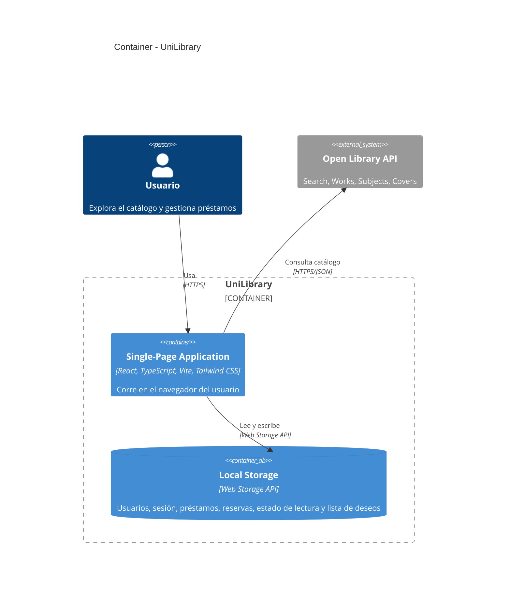
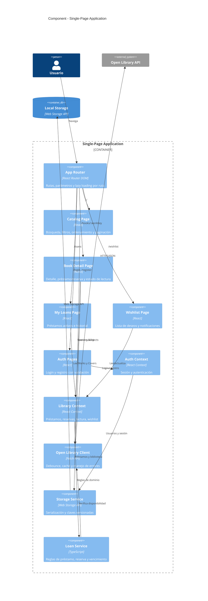
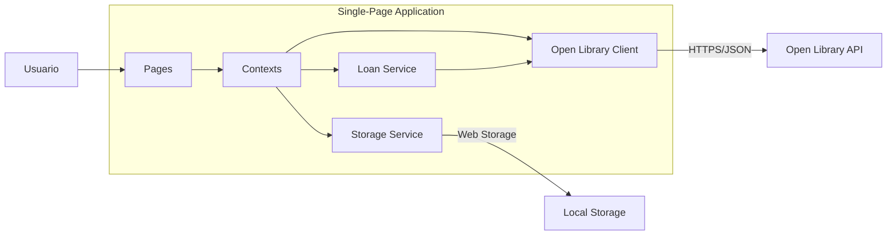

# Arquitectura del Frontend

Semana 2 - Diseño y Arquitectura

Documento de arquitectura de alto nivel de UniLibrary usando el modelo C4. Los diagramas están escritos en Mermaid (sintaxis C4*) y se renderizan directamente en GitHub.

## Nivel 1 - System Context

El sistema es una SPA que el usuario usa desde el navegador. Consume la API pública de Open Library para el catálogo. El Local Storage del navegador (persistencia) es parte del sistema y aparece en el nivel Container.



## Nivel 2 - Container

El sistema tiene un único container de ejecución (la SPA React en el navegador) y un container de persistencia proporcionado por el navegador (Local Storage). No hay backend propio.



## Nivel 3 - Component

Dentro de la SPA se identifican cuatro grupos: Router, Pages, State (Context API) y Services.



## Decisiones estructurales

### Dos contextos por dominio

El estado compartido se divide en dos contextos con responsabilidades acotadas, en lugar de un único contexto global. Esto evita re-renders innecesarios: la página de catálogo no se re-renderiza cuando cambia un préstamo, y viceversa.

| Contexto | Responsabilidad |
|---|---|
| Auth Context | Usuario activo, login, registro, logout, sesión persistida. |
| Library Context | Préstamos, reservas, historial, estado de lectura y lista de deseos del usuario. |

El estado del catálogo (consulta, filtros, ordenamiento, resultados y paginación) es local a la Catalog Page: solo esa página lo lee y modifica, por lo que vive en useState dentro del componente y se pasa por props a sus hijos. Un contexto aquí no aportaba nada: no hay consumidores fuera de la página. Revisión aplicada en Semana 3.

### Capa de servicios desacoplada de la UI

Los componentes nunca llaman a fetch ni a localStorage directamente. Toda interacción externa pasa por tres servicios:

| Servicio | Responsabilidad |
|---|---|
| Open Library Client | Peticiones HTTP con debounce, caché en memoria, header User-Agent identificado y manejo de errores. |
| Storage Service | Serialización JSON, claves versionadas (unilibrary:v1:*) y manejo de errores de cuota. |
| Loan Service | Reglas de negocio de préstamos y reservas, cálculo de fechas de vencimiento. |

### Disponibilidad simulada

Open Library no gestiona préstamos reales de la biblioteca universitaria. El Loan Service deriva la disponibilidad combinando el campo availability de la Search API con el estado local de préstamos de la aplicación.

## Flujo de datos principal



## Estructura de carpetas propuesta

```
src/
  app/
    App.tsx
    router.tsx
    providers.tsx
  pages/
    catalog/
    book-detail/
    loans/
    wishlist/
    auth/
  components/
    ui/
    books/
    layout/
  contexts/
    AuthContext.tsx
    LibraryContext.tsx
  hooks/
  services/
    open-library/
    storage/
    loans/
  types/
  utils/
  styles/
```

## Nota sobre los diagramas

Los diagramas usan la sintaxis C4 de Mermaid (C4Context, C4Container, C4Component). Se renderizan automáticamente al ver este archivo en GitHub o en editores con soporte Mermaid (VS Code con la extensión Markdown Preview Mermaid Support, por ejemplo).
