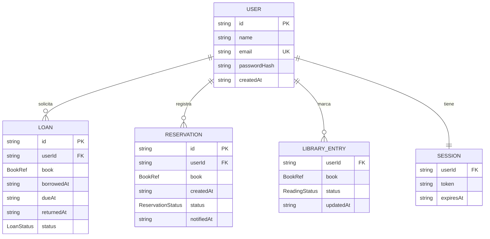

# Modelo de Datos

Semana 2 - Diseño y Arquitectura

Modelo de datos para usuarios, préstamos, reservas, estado de lectura y lista de deseos. Toda la persistencia es en Local Storage (ADR-004), por lo que las entidades se serializan como JSON en claves versionadas.

## Diagrama de entidades



## Tipos TypeScript

```ts
interface User {
  id: string;             // UUID v4
  name: string;
  email: string;          // único, usado para login
  passwordHash: string;   // nunca texto plano
  createdAt: string;      // ISO 8601
}

interface Session {
  userId: string;
  token: string;          // token pseudo-aleatorio de sesión
  expiresAt: string;      // ISO 8601
}

// Snapshot de los datos del libro tomado en el momento de la acción.
// Open Library puede cambiar sus datos; el snapshot hace que el
// historial sea autocontenido.
interface BookRef {
  workKey: string;        // e.g. "/works/OL166894W"
  editionKey?: string;    // e.g. "/books/OL7353617M"
  title: string;
  authors: string[];
  coverId?: number;       // cover_i, para reconstruir la URL de portada
  firstPublishYear?: number;
  subjects?: string[];    // categorías en el momento del registro
}

type LoanStatus = 'active' | 'returned' | 'overdue';

interface Loan {
  id: string;             // UUID v4
  userId: string;
  book: BookRef;
  borrowedAt: string;     // ISO 8601
  dueAt: string;          // ISO 8601, borrowedAt + LOAN_PERIOD_DAYS
  returnedAt: string | null;
  status: LoanStatus;     // 'overdue' se deriva: active && now > dueAt
}

type ReservationStatus = 'pending' | 'fulfilled' | 'cancelled';

interface Reservation {
  id: string;
  userId: string;
  book: BookRef;
  createdAt: string;
  status: ReservationStatus;
  notifiedAt: string | null; // cuando se notificó la disponibilidad
}

// Unifica el rastreador de estado de lectura (RF4.2) y la lista de
// deseos (RF5): un libro con status 'wishlist' forma parte de la
// lista de deseos del usuario.
type ReadingStatus = 'reading' | 'completed' | 'wishlist';

interface LibraryEntry {
  userId: string;
  book: BookRef;
  status: ReadingStatus;
  updatedAt: string;
}
```

## Notas de diseño

### Wishlist como estado de lectura

El capstone define Lista de deseos como un estado del rastreador de lectura (RF4.2) y también como una funcionalidad aparte con notificaciones (RF5). En lugar de dos colecciones duplicadas, un LibraryEntry con status wishlist cumple ambos requisitos: la Wishlist Page lista las entradas con ese status y las notificaciones de disponibilidad se generan al detectar que un libro de la lista pasa a disponible.

### Snapshot de datos del libro (BookRef)

Los préstamos, reservas y entradas de biblioteca guardan una copia de los campos relevantes del libro en el momento del registro. Esto permite renderizar el historial sin llamadas adicionales a la API y protege contra cambios en los datos de Open Library.

### Estado overdue derivado

Loan.status se almacena como active o returned; el estado vencido se calcula al leer (active y fecha actual mayor a dueAt) para evitar inconsistencias por paso del tiempo.

## Esquema de Local Storage

Las claves usan el prefijo unilibrary:v1:. La versión permite migrar datos en futuras iteraciones sin romper la app.

| Clave | Contenido | Tipo |
|---|---|---|
| unilibrary:v1:users | Todos los usuarios registrados | User[] |
| unilibrary:v1:session | Sesión activa o null | Session \| null |
| unilibrary:v1:loans:{userId} | Préstamos del usuario (activos e historial) | Loan[] |
| unilibrary:v1:reservations:{userId} | Reservas del usuario | Reservation[] |
| unilibrary:v1:library:{userId} | Estado de lectura y wishlist del usuario | LibraryEntry[] |
| unilibrary:v1:prefs:{userId} | Preferencias de UI (vista grilla/lista, último ordenamiento) | object |

## Reglas de negocio

| Regla | Detalle |
|---|---|
| Duración de préstamo | LOAN_PERIOD_DAYS = 14 días calendario desde borrowedAt. |
| Un préstamo activo por libro | Un usuario no puede tener dos préstamos activos del mismo workKey. |
| Reserva solo si está prestado | Solo se puede reservar un libro que esté en estado prestado. |
| Reserva a préstamo | Cuando un libro prestado se devuelve, la reserva pendiente más antigua pasa a fulfilled y se marca notifiedAt. |
| Wishlist a préstamo | Un libro en la wishlist puede tomarse prestado sin salir de la lista. |

## Limitaciones conocidas

- Local Storage tiene un límite aproximado de 5 MB por origen; el historial es pequeño en texto, por lo que no es un problema práctico.
- Los datos no se sincronizan entre navegadores ni dispositivos (fuera de alcance, ver `docs/planning/scope.md`).
- La autenticación es local y académica; el passwordHash usa una función de hash simple del lado del cliente, no un esquema de producción.
