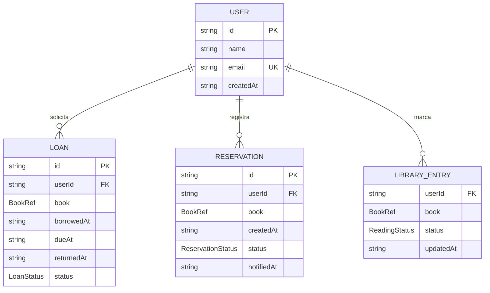

# Modelo de Datos

Semana 2 - Diseño y Arquitectura

Modelo de datos para usuarios, préstamos, reservas, estado de lectura y lista de deseos. La persistencia es en Postgres de Supabase (ADR-007) y las reglas de préstamo multiusuario se aplican en la base de datos (ADR-008). El modelo original en Local Storage quedó reemplazado.

## Diagrama de entidades



## Tipos TypeScript

```ts
// El usuario lo gestiona Supabase Auth (auth.users); la app solo
// expone los campos públicos que usa la interfaz.
interface PublicUser {
  id: string;             // UUID de auth.users
  name: string;
  email: string;          // único, usado para login
  createdAt: string;      // ISO 8601
}

// Snapshot de los datos del libro tomado en el momento de la acción.
// Open Library puede cambiar sus datos; el snapshot hace que el
// historial sea autocontenido.
interface BookRef {
  workKey: string;        // e.g. "OL166894W", sin el prefijo /works/
  editionKey?: string;    // e.g. "OL7353617M"
  title: string;
  authors: string[];
  coverId?: number;       // cover_i, para reconstruir la URL de portada
  firstPublishYear?: number;
}

type LoanStatus = 'active' | 'returned';

interface Loan {
  id: string;             // UUID v4
  userId: string;
  book: BookRef;
  borrowedAt: string;     // ISO 8601
  dueAt: string;          // ISO 8601, borrowedAt + LOAN_PERIOD_DAYS
  returnedAt: string | null;
  status: LoanStatus;     // 'overdue' se deriva: active && now > dueAt
}

type ReservationStatus = 'pending' | 'fulfilled' | 'cancelled';

interface Reservation {
  id: string;
  userId: string;
  book: BookRef;
  createdAt: string;
  status: ReservationStatus;
  notifiedAt: string | null; // cuando se notificó la disponibilidad
}

// Unifica el rastreador de estado de lectura (RF4.2) y la lista de
// deseos (RF5): un libro con status 'wishlist' forma parte de la
// lista de deseos del usuario.
type ReadingStatus = 'reading' | 'completed' | 'wishlist';

interface LibraryEntry {
  userId: string;
  book: BookRef;
  status: ReadingStatus;
  updatedAt: string;
}
```

## Notas de diseño

### Wishlist como estado de lectura

El capstone define Lista de deseos como un estado del rastreador de lectura (RF4.2) y también como una funcionalidad aparte con notificaciones (RF5). En lugar de dos colecciones duplicadas, un LibraryEntry con status wishlist cumple ambos requisitos: la Wishlist Page lista las entradas con ese status y las notificaciones de disponibilidad se generan al detectar que un libro de la lista pasa a disponible.

### Snapshot de datos del libro (BookRef)

Los préstamos, reservas y entradas de biblioteca guardan una copia de los campos relevantes del libro en el momento del registro. Esto permite renderizar el historial sin llamadas adicionales a la API y protege contra cambios en los datos de Open Library.

### Estado overdue derivado

Loan.status se almacena como active o returned; el estado vencido se calcula al leer (active y fecha actual mayor a dueAt) para evitar inconsistencias por paso del tiempo.

## Esquema en Supabase

Las entidades anteriores persisten como tablas Postgres con Row Level Security. Los scripts completos están en `webdev-capstone/supabase/schema.sql` y `webdev-capstone/supabase/002_multiuser_library.sql`.

| Tabla | Contenido | Clave |
|---|---|---|
| loans | Préstamos de todos los usuarios (activos e historial) | id |
| reservations | Reservas de los usuarios | id |
| library_entries | Estado de lectura y wishlist por usuario | (user_id, work_key) |

Notas del esquema:

- El snapshot del libro se guarda en columnas snake_case (work_key, edition_key, title, authors, cover_id, first_publish_year) en las tres tablas.
- work_key se almacena sin el prefijo /works/ para coincidir con el parámetro de ruta /books/:workKey.
- El cliente solo puede insertar el user_id y las columnas del snapshot; status y fechas las asigna la base de datos mediante defaults y funciones.
- Un índice único parcial garantiza un solo préstamo activo por work_key entre todos los usuarios.
- La devolución se ejecuta con la función return_loan, que además cumple la reserva pendiente más antigua en la misma transacción.
- La disponibilidad se consulta con la función loaned_work_keys, que devuelve solo los work keys con préstamo activo sin exponer el propietario.

## Reglas de negocio

| Regla | Detalle |
|---|---|
| Duración de préstamo | 14 días calendario desde borrowed_at, calculada por la base de datos (default due_at). |
| Un préstamo activo por libro | Solo puede existir un préstamo activo por work_key entre todos los usuarios (un ejemplar por libro). |
| Reserva solo si está prestado por otro | Solo se puede reservar un libro que tenga préstamo activo de otro usuario; la política de inserción lo exige. |
| Reserva a préstamo | Cuando el préstamo se devuelve con return_loan, la reserva pendiente más antigua pasa a fulfilled y se marca notified_at en la misma transacción. |
| Wishlist a préstamo | Un libro en la wishlist puede tomarse prestado sin salir de la lista. |

## Limitaciones conocidas

- Una reserva cumplida no aparta el libro: cuando queda disponible lo toma el primer usuario que lo solicite (ver ADR-008).
- La disponibilidad se calcula por página de resultados; un cambio reciente de otro usuario puede tardar una interacción en reflejarse.
- Los proyectos de Supabase en plan Free se pausan tras 7 días de inactividad; el proyecto se mantiene activo durante el desarrollo.
