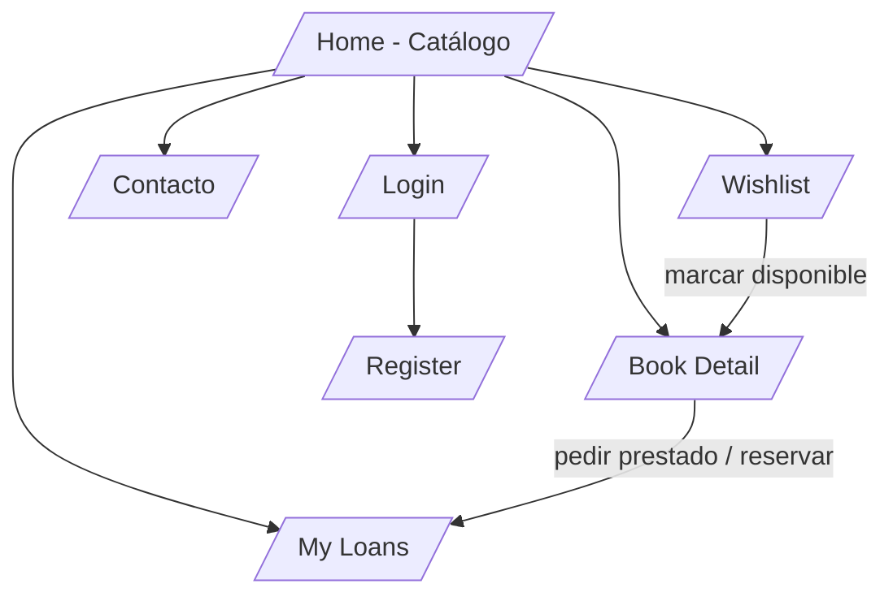
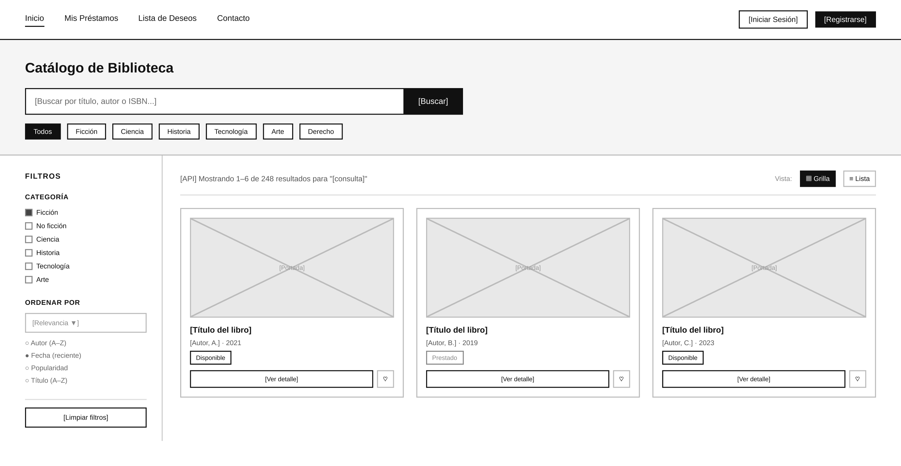

# Maquetas UI/UX

Semana 2 - Diseño y Arquitectura

Maquetas de las páginas clave de UniLibrary. La referencia visual principal es el wireframe de la página de catálogo; el resto de páginas se especifican en texto para mantener consistencia con ese estilo (alto contraste, marcos simples, badges de estado).

## Mapa de navegación

| Ruta | Página | Requiere sesión |
|---|---|---|
| / | Catálogo (Home) | No |
| /books/:workKey | Detalle del libro | No (préstamo/reserva sí) |
| /loans | Mis Préstamos | Sí |
| /wishlist | Lista de Deseos | Sí |
| /contact | Contacto | No |
| /login | Iniciar Sesión | No |
| /register | Registrarse | No |

## Página de Catálogo (Home)

Elementos identificados en la maqueta:

| Zona | Elementos |
|---|---|
| Header | Navegación: Inicio, Mis Préstamos, Lista de Deseos, Contacto. Acciones: Iniciar Sesión, Registrarse. Con sesión activa los botones se reemplazan por el nombre del usuario y Cerrar sesión. |
| Título | Catálogo de Biblioteca. |
| Búsqueda | Input Buscar por título, autor o ISBN... + botón Buscar. Aplica debounce en escritura además del submit. |
| Categorías rápidas | Pills: Todos, Ficción, Ciencia, Historia, Tecnología, Arte, Derecho. Mapean a subjects de Open Library. |
| Sidebar de filtros | CATEGORÍA (checkboxes), ORDENAR POR (dropdown Relevancia + radios Autor A-Z, Fecha reciente, Popularidad, Título A-Z), botón Limpiar filtros. |
| Resultados | Texto Mostrando X-Y de N resultados para consulta + toggle de vista Grilla/Lista. |
| Tarjeta de libro | Portada, título, autor y año, badge de disponibilidad (Disponible/Prestado), botón Ver detalle, icono corazón para wishlist. |

### Comportamiento responsivo (mobile-first)

- En móvil el sidebar de filtros colapsa en un botón Filtros que abre un drawer/modal.
- Las pills de categorías pasan a scroll horizontal.
- La grilla de resultados pasa de 3 columnas (desktop) a 2 (tablet) y 1 (móvil).
- El header colapsa la navegación en un menú hamburguesa.

## Detalle del libro (/books/:workKey)

| Zona | Contenido |
|---|---|
| Columna izquierda | Portada grande (Covers API tamaño L con lazy loading). |
| Columna derecha | Título, autor(es), año de publicación, géneros (subjects como chips), descripción (Works API), badge de disponibilidad. |
| Acciones | Botón Pedir prestado (si disponible) o Reservar (si prestado). Selector de estado de lectura: Leyendo / Completado / Lista de deseos. |
| Contexto | Enlace Volver al catálogo conservando filtros activos. |

## Mis Préstamos (/loans)

| Sección | Contenido |
|---|---|
| Préstamos activos | Lista/tabla: portada pequeña, título, fecha de préstamo, fecha de vencimiento con indicador visual (próximo a vencer / vencido), botón Devolver. |
| Reservas | Reservas pendientes con fecha de solicitud y estado. |
| Historial | Préstamos devueltos con rango de fechas. |

## Lista de Deseos (/wishlist)

- Lista de libros marcados con status wishlist: portada, título, autor, badge de disponibilidad.
- Notificación inline cuando un libro de la lista pasa a disponible (banner o badge Nuevo disponible).
- Acciones por item: Ver detalle, Pedir prestado (si disponible), Quitar de la lista.

## Login y Registro (/login, /register)

- Formulario centrado con validación de cliente: email con formato válido, contraseña con longitud mínima, confirmación de contraseña en registro.
- Errores de validación junto a cada campo y mensajes accesibles (aria-describedby).
- Enlace cruzado entre login y registro.

## Contacto (/contact)

- Formulario simple: nombre, email, asunto, mensaje. Validación de cliente y confirmación de envío (almacenamiento local o stub).

## Lineamientos de accesibilidad aplicados a las maquetas

- Toda acción alcanzable por teclado: la grilla usa tarjetas con foco visible y orden de tabulación lógico.
- Landmarks: header con nav, aside para filtros, main para resultados.
- El toggle Grilla/Lista usa aria-pressed; los badges de disponibilidad no dependen solo del color (texto Disponible/Prestado).
- Formularios con label asociado a cada input y aria-live para mensajes de error y conteo de resultados.
